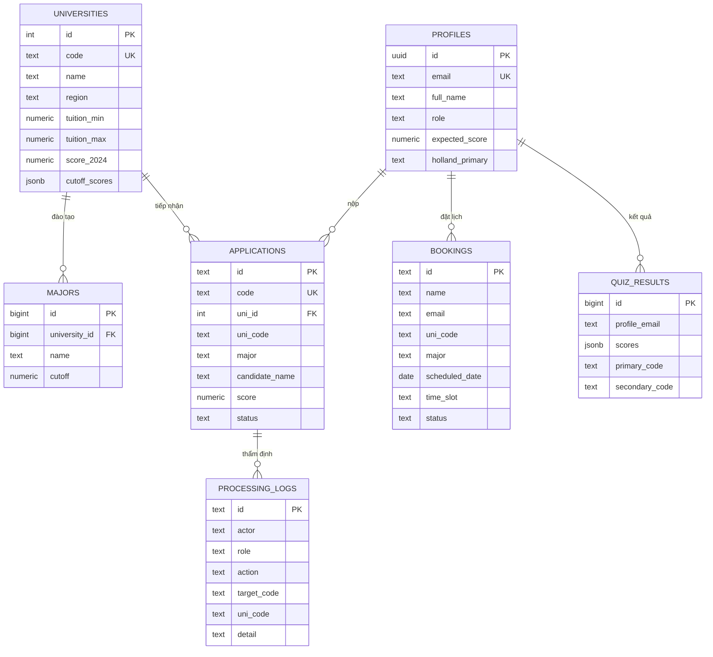

# 🎓 UNIPATH 2.0 - HỆ SINH THÁI HƯỚNG NGHIỆP & TUYỂN SINH ĐẠI HỌC THÔNG MINH
### 📱 Mobile-First Native (< 1024px) & 💻 Desktop Widescreen (≥ 1024px) Tự Động Thích Ứng 100%

[](https://uni5hoanthanh.vercel.app)
[](https://react.dev/)
[](https://www.typescriptlang.org/)
[](https://vite.dev/)
[](https://vitest.dev/)

> 🌐 **Trang web chính thức:** [https://uni5hoanthanh.vercel.app](https://uni5hoanthanh.vercel.app)  
> **UniPath 2.0** là hệ sinh thái số toàn diện đồng hành cùng học sinh THPT (đặc biệt là 2k8, 2k9) và quý phụ huynh trên hành trình khám phá bản thân, chọn ngành, chọn trường và nộp hồ sơ xét tuyển đại học trực tuyến. Hệ thống tích hợp trắc nghiệm hướng nghiệp quốc tế **Holland RIASEC (12 câu hỏi chuẩn hóa)**, thuật toán đối soát **AI Matching 2026** trên cơ sở dữ liệu **30 trường đại học hàng đầu 3 miền Bắc – Trung – Nam**, ngày hội tuyển sinh trực tuyến **EduFair**, đặt lịch **Tư vấn 1-1** theo thời gian thực và kiến trúc phân quyền đa cổng **RBAC 3 vai trò độc lập** vận hành trên ngôn ngữ thiết kế **Aurora Deep Tech & Glassmorphism**.

---

## 👥 ĐƠN VỊ PHÁT TRIỂN & BẢN QUYỀN DỰ ÁN

Dự án được nghiên cứu, thiết kế và phát triển bởi **Nhóm UP5** thuộc **Trường Đại học Phú Xuân (PXU)**:

* 👑 **Trưởng nhóm UP5:** **Dương Đình Phát**
* 💻 **Kỹ sư phát triển phần mềm (Phát triển App):** **Trần Công Quý**
* 🤝 **Thành viên nhóm UP5:**
  * **Trần Thị Nhung**
  * **Nguyễn Thị Lý Trà My**
  * **Thái Thị Nga**
* 🏛️ **Đơn vị chủ quản & Đào tạo:** **Trường Đại học Phú Xuân (PXU)**

> **© Bản quyền dự án thuộc về Nhóm UP5 — Trường Đại học Phú Xuân (PXU). Phát triển ứng dụng bởi Trần Công Quý.**

---

## 📚 BỘ HỒ SƠ TÀI LIỆU DỰ ÁN ĐỒNG BỘ 100%

Toàn bộ hệ thống được tài liệu hóa đồng bộ 100% với mã nguồn thực tế qua bộ tài liệu chuyên sâu:

1. 📖 **[USER_GUIDE.md](USER_GUIDE.md):** Cẩm nang hướng dẫn sử dụng chi tiết từng màn hình, từng luồng thao tác cho Thí sinh, Ban Tuyển sinh ĐH Phú Xuân (PXU), và Admin Hệ thống.
2. 📋 **[01-NGHIEP-VU.md](01-NGHIEP-VU.md):** Phân tích nghiệp vụ tuyển sinh đại học 2026, cơ sở khoa học trắc nghiệm Holland RIASEC (12 câu hỏi / 6 nhóm), công thức định lượng `MatchingService.ts`, vòng đời 6 trạng thái hồ sơ xét tuyển, quy trình đặt lịch tư vấn 1-1 và logic đồng bộ pha EduFair (`src/utils/edufair.ts`).
3. 🎨 **[02-GIAO-DIEN-AI.md](02-GIAO-DIEN-AI.md):** Kiến trúc giao diện thích ứng kép tự động (`Mobile < 1024px` & `Desktop ≥ 1024px`), ngôn ngữ thẩm mỹ Aurora Deep Tech, dock Trợ lý AI cố định đa lượt, thanh điều hướng 3 tầng cố định không che khuất, và chuẩn chống tràn ngang (`overflow-x: clip`).
4. 💻 **[03-KY-THUAT-FRONTEND.md](03-KY-THUAT-FRONTEND.md):** Kiến trúc kỹ thuật React 19 + TypeScript 5.9 + Vite 8, cơ chế lưu trữ hai tầng bền vững (`Shared Institutional Store` & `Per-User Personal Store`), màn hình chờ `AppLoadingScreen`, cơ chế bắt lỗi `ErrorBoundary` và danh mục 13 Modal tương tác.
5. 🛡️ **[04-KY-THUAT-ADMIN.md](04-KY-THUAT-ADMIN.md):** Đặc tả kiến trúc phân quyền truy cập **RBAC 3 vai trò**, rào bảo vệ **Auth Gate** (loại bỏ hoàn toàn tài khoản khách), Cổng Admin chuyên sâu (Benchmark 30 trường 6 phân khoảng, Quản trị hệ thống & Audit Log, Global Search Ctrl+K, Fixed 3-Tier Sidebar) và Cổng PXU độc quyền.
6. 🎯 **[PRODUCT.md](PRODUCT.md):** Tầm nhìn sản phẩm, nguyên tắc dữ liệu chân thực và các đối tượng sử dụng chính.
7. 📐 **[DESIGN.md](DESIGN.md):** Hệ thống Design System & Tokens CSS, bảng màu Aurora, quy chuẩn WCAG/W3C và bộ components dùng chung.
8. 🎬 **[DEMO-SCRIPT.md](DEMO-SCRIPT.md):** Kịch bản trình diễn đồ án chuẩn 5 phút phân bổ từng phút kèm lời thoại mẫu.
9. 🇬🇧 **[DEFENSE-EN.md](DEFENSE-EN.md):** Dàn ý bảo vệ đồ án bằng tiếng Anh và giải trình 10 câu hỏi cốt lõi của Hội đồng chấm thi.
10. 📝 **[AI-INTERACTION-LOG.md](AI-INTERACTION-LOG.md):** Nhật ký tương tác AI 18 phiên có cấu trúc chuẩn 8 cột, ghi nhận chi tiết các ca AI sinh code và ca con người sửa đè/từ chối AI.
11. 🧠 **[LEARNING-LOG.md](LEARNING-LOG.md):** Nhật ký ghi nhận quá trình học công nghệ và 8 tình huống thực tế con người phát hiện, sửa chữa ảo tưởng của AI.
12. 📊 **[SELF-ASSESSMENT-CLO.md](SELF-ASSESSMENT-CLO.md):** Báo cáo tự đánh giá chuẩn đầu ra môn học CLO1 – CLO6 kèm bằng chứng kỹ thuật.

---

## 🔐 MA TRẬN TÀI KHOẢN & PHÂN QUYỀN HỆ THỐNG (RBAC)

UniPath 2.0 triển khai rào chắn **Auth Gate an toàn tuyệt đối**: Người dùng bắt buộc phải đăng nhập hoặc đăng ký tài khoản trước khi truy cập bất kỳ phân hệ nào của ứng dụng. Hệ thống cung cấp sẵn 3 tài khoản mẫu định cấu hình sẵn (hỗ trợ nút **Điền sẵn thông tin 1-Click** tại màn hình `AuthScreen`) phục vụ hội đồng chấm thi và người dùng:

| Vai trò (Role) | Email đăng nhập | Mật khẩu | Cổng giao diện & Quyền hạn cốt lõi | Ranh giới bảo mật (Data Isolation) |
| :--- | :--- | :---: | :--- | :--- |
| **Thí sinh 2k8**<br>*(Trần Công Quý)* | `quy@unipath.vn` | `123456` | **Student Portal (`MobileView` / `DesktopView`):** Làm trắc nghiệm RIASEC, chạy AI Matching, xem EduFair, nộp hồ sơ xét tuyển sớm, bổ sung minh chứng khi thiếu hồ sơ, rút hồ sơ cá nhân, đặt lịch tư vấn 1-1, hỏi đáp AI Assistant dock cố định, nâng cấp VIP. | **Bảo mật cá nhân tuyệt đối:** Chỉ xem được hồ sơ (`myApplications`), lịch hẹn (`myBookings`) và thông báo của chính email mình; không xem được dữ liệu thí sinh khác; không có quyền duyệt hồ sơ hay sửa CSDL trường. |
| **ĐH Phú Xuân**<br>*(Ban Tuyển Sinh PXU)* | `tuyensinh@pxu.edu.vn` | `pxu123` | **PXU Admissions Portal (`UniversityApp.tsx`):** Dashboard CRM tuyển sinh PXU với thanh điều hướng 3 tầng cố định màu Emerald Aurora, duyệt hồ sơ nộp vào PXU (`Hồ sơ hợp lệ`, `Đã trúng tuyển`, `Thiếu hồ sơ`, `Đã bị hủy` kèm ghi chú hội đồng), đối soát điểm chuẩn ngành PXU & đề xuất học bổng OJT, điều phối Kanban lịch hẹn 1-1 của PXU, cập nhật điểm chuẩn tham chiếu & học phí tối thiểu của riêng PXU. | **Phân lập cấp cơ sở đào tạo:** Chỉ truy cập dữ liệu có `uniCode === 'PXU'` (`id === 11`); chặn hoàn toàn quyền xem/duyệt hồ sơ hoặc chỉnh sửa điểm chuẩn của 29 trường đại học còn lại; không nộp hồ sơ như thí sinh. |
| **Admin Hệ Thống**<br>*(Quản trị Cấp cao)* | `admin@unipath.vn` | `admin123` | **System Admin Portal (`AdminApp.tsx`):** Trung tâm điều hành tuyển sinh SaaS toàn quốc với thanh điều hướng 3 tầng cố định Deep Aurora, Tab Benchmark 30 trường (biểu đồ cột phân bố điểm 6 phân khoảng, điểm TB 3 miền, top ngành), Tab Quản trị hệ thống (giám sát Supabase Cloud, LocalStorage, Audit Log), Global Search (`Ctrl+K`), duyệt đơn lẻ hoặc hàng loạt (Batch Action) hồ sơ toàn quốc, điều phối lịch hẹn 1-1, chỉnh sửa điểm chuẩn 30 trường (đồng bộ tức thì sang AI Matching), quản lý tài khoản. | Không thực hiện các hành vi cá nhân của thí sinh (nộp hồ sơ xét tuyển, đặt lịch tư vấn hay nâng cấp VIP thí sinh). |

> **Ghi chú về cơ chế bảo vệ:** Hệ thống **đã loại bỏ hoàn toàn chế độ Khách vãng lai** để ngăn chặn triệt để nguy cơ thất thoát dữ liệu và rò rỉ phiên làm việc. Mọi mật khẩu được băm một chiều bằng thuật toán **Salted SHA-256** (`src/utils/security.ts`).

---

## 🗺️ BẢNG ÁNH XẠ CHỨC NĂNG & LUỒNG NÚT BẤM (BUTTON & FLOW MATRIX)

Mọi nút bấm trên hệ thống đều được kết nối đúng chức năng thực tế, liên thông dữ liệu xuyên suốt giữa các vai trò:

| Vị trí / Nút bấm | Hành vi xử lý (Action) | Đích đến / Kết quả hiển thị |
| :--- | :--- | :--- |
| **Tự động nhận diện thiết bị** | Mở web trên điện thoại/tablet (`< 1024px`) hoặc laptop/PC (`≥ 1024px`) | Tự động render `MobileView` hoặc `DesktopView` mượt mà, **không có nút chuyển giao diện thủ công và không hiện thông báo toast** |
| **Màn hình Xác thực (`AuthScreen`)** | Đăng nhập tài khoản, đăng ký thí sinh mới hoặc bấm nút tài khoản Demo | Kiểm tra mật khẩu băm Salted SHA-256, chuyển hướng ngay vào Cổng tương ứng theo vai trò |
| **Logo UniPath (Header Desktop)** | Đưa người dùng về màn hình chính | Chuyển về **Tab 0 (Trang chủ)** và cuộn mượt lên đầu trang |
| **Thanh Điều Hướng 5 Tabs (Thí sinh)** | Chuyển đổi giữa 5 phân hệ của Cổng Thí sinh | **Tab 0:** Trang chủ • **Tab 1:** Trắc nghiệm Holland • **Tab 2:** Gợi ý AI • **Tab 3:** EduFair • **Tab 4:** Hồ sơ & Cá nhân |
| **Chuông Thông Báo (`Bell`)** | Mở trung tâm thông báo theo đúng vai trò/email | Mở **`NotificationsModal`** hiển thị số tin chưa đọc thực tế (`unreadNotificationCount`), đánh dấu đã đọc & điều hướng nhanh |
| **Menu Tài Khoản & Đổi Vai Trò (`AccountRoleMenu`)** | Mở menu tài khoản góc phải trên ở cả 3 cổng | Hiển thị danh tính hiện tại, **chuyển nhanh 1-Click giữa 3 cổng (`Thí sinh` ↔ `ĐH Phú Xuân` ↔ `Admin`)**, mở Cài đặt, Khôi phục dữ liệu gốc hoặc Đăng xuất ngay |
| **Trợ Lý AI Dock Cố Định (`AIAssistantDock`)** | Dock cố định ở góc dưới bên phải màn hình Desktop | Thu nhỏ / mở rộng mượt mà, tư vấn 24/7 với bộ nhớ hội thoại đa lượt và dữ liệu tuyển sinh 30 trường |
| **Tìm kiếm Toàn diện Admin (`Ctrl + K`)** | Bấm tổ hợp phím `Ctrl + K` hoặc bấm thanh tìm kiếm header Admin | Mở modal **`AdminGlobalSearch`** tra cứu tức thì thí sinh, trường đại học, ngành học và chức năng quản trị |
| **Thanh Điều hướng Cố định 3 Tầng (Admin & PXU)** | Thanh sidebar cố định bên trái màn hình (`position: fixed`) | Pinned Header (Logo/Tên trường) luôn neo đỉnh, Middle Menu cuộn độc lập lướt lên/xuống mượt mà, Pinned Footer neo đáy không bị che khuất |
| **Thẻ Trường Đại học (`UniversityCard`)** | Hiển thị thẻ trường thiết kế Aurora | Ảnh campus thật 30/30 trường từ `campus_*.jpg`, logo badge bo tròn trọn vẹn, điểm chuẩn 3 năm và học phí |
| **Nút Trái Tim (`Heart`)** | Lưu / bỏ lưu trường đại học yêu thích | Cập nhật `favoriteIds` trong kho dữ liệu riêng của người dùng, đồng bộ sang Tab 4 |
| **Nút So Sánh (`Scale`) & Thanh Nổi** | Chọn tối đa 3 trường để đối chiếu song song | Hiển thị thanh nổi **`So sánh (n/3)`** → Bấm mở **`CompareModal`** đối chiếu điểm chuẩn, học phí, việc làm |
| **Nút "Nộp hồ sơ xét tuyển"** | Khởi tạo hồ sơ xét tuyển sớm | Mở **`ApplyDemoModal`** 3 bước → Tạo mã hồ sơ `HS-2026-UNIxxxx` đẩy thẳng sang cổng Admin & cổng trường (nếu nộp PXU) |
| **Nút "Tư vấn 1-1" / "Đặt lịch 1-1"** | Đặt lịch gặp trực tiếp giảng viên / ban tuyển sinh | Mở **`BookConsultationModal`** chọn trường, ngành, ngày giờ, hình thức (`Google Meet 1-1`, `Zalo`, `Trực tiếp`) → Đồng bộ sang Tab 4, Admin & PXU |
| **Tab 1: Trắc nghiệm Holland RIASEC** | Hoàn thành 12 câu hỏi tình huống (thang điểm 0–3) | Vẽ biểu đồ **Radar SVG 6 trục**, xác định mã Holland chủ đạo, mở **`CareerPathModal`** hoặc chuyển thẳng sang AI Matching |
| **Tab 2: "Phân tích cơ hội trúng tuyển"** | Chốt Điểm dự kiến, Ngân sách học phí & Khu vực | Thực thi `evaluateMatching()` phân 3 nhóm: **An Toàn (`≥ 80%`)**, **Vừa Sức (`45% – 79%`)**, **Thử Thách (`< 45%`)** |
| **Tab 3: EduFair Phân Pha Tự Động** | Khám phá ngày hội tuyển sinh ảo theo phase chuẩn | Đồng hồ đếm ngược chuẩn xác đến EduFair Finale (20/12/2026); tự động chuyển giao diện theo phase `upcoming`, `live`, `ended` |
| **Tab 4 (Thí sinh): "Chi tiết / Bổ sung"** | Xem tiến độ duyệt, giấy báo trúng tuyển hoặc nộp bổ sung minh chứng | Mở **`ViewApplicationModal`**: Hiển thị **Giấy báo Đủ điều kiện Trúng tuyển sớm** (khi `Đã trúng tuyển`) hoặc form **Bổ sung minh chứng** (khi `Thiếu hồ sơ`) |
| **Cổng PXU: Thẩm định hồ sơ nộp PXU** | Bấm *Hồ sơ hợp lệ*, *Duyệt trúng tuyển*, *Yêu cầu bổ sung* hoặc *Từ chối* | Tự động đối soát chuẩn ngành PXU & đề xuất học bổng OJT; cập nhật trạng thái hồ sơ tức thì kèm ghi chú hội đồng |
| **Cổng Admin: Benchmark 30 Trường ĐH** | Mở tab Benchmark trên thanh điều hướng | Xem biểu đồ phân bố điểm chuẩn 6 phân khoảng (Histogram), tỷ lệ đạt chuẩn ngành, top 3 ngành cạnh tranh nhất |
| **Cổng Admin: Quản trị Hệ thống & Audit Log** | Mở tab Quản trị hệ thống | Giám sát kết nối Supabase Cloud Mirroring, dung lượng LocalStorage, và toàn bộ dòng lịch sử kiểm toán hồ sơ |

---

## 🛠️ HƯỚNG DẪN CÀI ĐẶT & KHỞI CHẠY DỰ ÁN (LOCAL DEVELOPMENT)

### Yêu cầu môi trường
* **Node.js:** Phiên bản `18.x` trở lên (khuyến nghị `Node.js 20 LTS` hoặc mới hơn).
* **Trình quản lý gói:** `npm`.

### Các bước thực thi chuẩn:
```bash
# 1. Di chuyển vào thư mục dự án
cd "d:\VSCODE PXU K22\unipath-web"

# 2. Cài đặt các gói phụ thuộc
npm install

# 3. Khởi chạy máy chủ phát triển (Vite Dev Server)
npm run dev

# 4. Kiểm tra chất lượng mã nguồn (ESLint - 0 lỗi, 0 cảnh báo)
npm run lint

# 5. Chạy bộ kiểm thử tự động 77 ca nghiệp vụ (Vitest - 100% Passed)
npm test

# 6. Kiểm tra kiểu tĩnh TypeScript & Đóng gói bản Production
npm run build
```

---

## 🧪 BỘ KIỂM THỬ TỰ ĐỘNG VITEST (77 TESTS / 6 TEST SUITES)

Dự án duy trì kỷ luật chất lượng phần mềm cao nhất với **77 bài kiểm thử đơn vị tự động** bao phủ toàn diện mọi quy tắc nghiệp vụ cốt lõi, chạy hoàn tất trong ~450ms:

1. **`src/__tests__/businessRules.test.ts` (42 tests):** Kiểm thử máy trạng thái FSM hồ sơ 6 bước, quy tắc chặn nộp trùng cùng ngành, giới hạn tối đa 5 nguyện vọng hoạt động, kiểm tra điểm biên (từ chối điểm âm hoặc > 30.0đ), tie-breaking trắc nghiệm Holland (loại trừ nhóm 0 điểm), và phòng vệ chống tấn công CSV Formula Injection theo chuẩn OWASP.
2. **`src/__tests__/adminAnalytics.test.ts` (16 tests):** Kiểm thử tính toán thống kê KPI toàn quốc, phân bố điểm chuẩn 6 phân khoảng (Histogram buckets), điểm trung bình theo 3 miền Bắc – Trung – Nam, tỷ lệ đạt chuẩn ngành và danh sách top ngành cạnh tranh.
3. **`src/__tests__/authGateAndPanel.test.ts` (5 tests):** Kiểm thử rào chắn Auth Gate (bắt buộc đăng nhập, loại bỏ hoàn toàn tài khoản khách) và trạng thái thu nhỏ mặc định của AI Assistant dock.
4. **`src/__tests__/errorBoundary.test.tsx` (5 tests):** Kiểm thử cơ chế bắt lỗi runtime của `ErrorBoundary`, giao diện fallback an toàn khi render component lỗi, và hành động khôi phục dữ liệu mẫu.
5. **`src/__tests__/aiChatService.test.ts` (5 tests):** Kiểm thử tích hợp AI Assistant, context dữ liệu tuyển sinh 30 trường và trường PXU, bộ nhớ hội thoại đa lượt (multi-turn memory) và cơ chế chuyển đổi dự phòng offline an toàn khi mất mạng.
6. **`src/__tests__/edufair.test.ts` (4 tests):** Kiểm thử hàm phân loại pha sự kiện `getEventPhase` (`upcoming`, `live`, `ended`) và bộ đếm ngược thời gian chính xác tới ngày hội tuyển sinh EduFair Finale 20/12/2026.

---

## ⚙️ CẤU HÌNH BIẾN MÔI TRƯỜNG (ENVIRONMENT VARIABLES)

Hệ thống hỗ trợ cấu hình linh hoạt thông qua tệp `.env` (máy cục bộ) hoặc cấu hình Environment Variables trên Vercel:

| Tên biến môi trường | Giá trị mặc định | Bắt buộc | Ý nghĩa kỹ thuật & Ranh giới bảo mật |
| :--- | :---: | :---: | :--- |
| `VITE_SUPABASE_URL` | `""` | Tùy chọn | URL endpoint của dự án Supabase (VD: `https://xyzcompany.supabase.co`). Dùng để gọi Edge Function và đồng bộ dữ liệu đám mây. Nếu để trống, hệ thống tự động chạy chế độ Mock/Offline an toàn. |
| `VITE_SUPABASE_ANON_KEY` | `""` | Tùy chọn | Khóa Public/Anon Key của Supabase để xác thực yêu cầu từ trình duyệt. |
| `VITE_ENABLE_DEMO_MODE` | `"false"` | **Khuyến nghị** | Cờ kiểm soát cơ chế Demo Sandbox: <br>• Khi là `"false"` (mặc định trên Production): Toàn bộ cơ chế chuyển nhanh Demo bị vô hiệu hóa cứng, ẩn 100% công tắc trên giao diện, bắt buộc đăng nhập bằng mật khẩu.<br>• Khi là `"true"`: Chỉ người dùng **đã đăng nhập quyền Admin** mới có thể bật/tắt công tắc kiểm thử hội đồng. |

---

## 🗄️ KIẾN TRÚC CƠ SỞ DỮ LIỆU & QUY TRÌNH SUPABASE (DATABASE ARCHITECTURE)

Hệ thống cơ sở dữ liệu của **UniPath 2.0** được xây dựng trên nền tảng **PostgreSQL (Supabase project ref: `uclleeywalenfwfoonjl`)** với bảo mật cấp hàng (Row Level Security - RLS) nghiêm ngặt.

### 1. Sơ Đồ 7 Bảng Dữ Liệu Quan Hệ (Database Tables)



1. **`public.profiles`**: Hồ sơ người dùng và phân quyền RBAC (`student`, `admin`, `university_pxu`).
2. **`public.universities`**: Danh mục 30 trường Đại học Bắc – Trung – Nam, học phí sàn/trần, điểm sàn năm 2024. Cột `cutoff_scores` (jsonb) được giữ lại để tương thích ngược 100% với client hiện hành.
3. **`public.majors`**: Chuẩn hóa dữ liệu ngành đào tạo (1-n với `universities`), quản lý mã trường, tên ngành và điểm chuẩn tuyển sinh (120 ngành cho 30 trường).
4. **`public.applications`**: Hồ sơ xét tuyển trực tuyến, mã hồ sơ chuẩn hóa, điểm xét tuyển, máy trạng thái FSM 6 bước và partial index chống nộp trùng.
5. **`public.bookings`**: Đặt lịch hẹn tư vấn 1-1 trực tuyến với ban tuyển sinh các trường.
6. **`public.processing_logs`**: Nhật ký kiểm toán thẩm định hồ sơ của hội đồng tuyển sinh.
7. **`public.quiz_results`**: Lưu trữ kết quả trắc nghiệm định hướng nghề nghiệp Holland (điểm số 6 nhóm RIASEC, nhóm trội chính, nhóm phụ).

---

### 2. Cơ Chế Nạp Dữ Liệu Hybrid (Supabase REST + Safe MockData Fallback)

Ứng dụng hoạt động theo cơ chế **Hybrid Data Loading**:
- **Khởi động**: App kích hoạt `fetchUniversitiesFromCloud()` qua REST API Supabase với bộ đếm thời gian giới hạn **4 giây** (`AbortController`).
- **Trộn dữ liệu (`mergeUniversitiesWithCloud`)**:
  - Cột phía Database quản lý (`id`, `code`, `name`, `loc`, `region`, `tuitionMin`, `tuitionMax`, `score2024`, `cutoffScores`): Lấy trực tiếp từ Supabase DB.
  - Cột giao diện phong phú phía client (`majors`, `rating`, `desc`, `employmentRate`, `score2022`, `score2023`, `emoji`): Bảo toàn nguyên vẹn từ `MockData.ts`.
- **Dự phòng an toàn (Zero Disruption Fallback)**: Nếu mất mạng, hết thời gian chờ 4s hoặc chưa cấu hình biến môi trường Supabase, app tự động dùng 100% dữ liệu từ `MockData.ts`. Giao diện hoạt động trơn tru không hiện bất kỳ lỗi nào với người dùng. Cờ trạng thái nguồn dữ liệu được ghi rõ tại Console: `[UniPath Data]`.

---

### 3. Thứ Tự Chạy Script SQL Khi Cài Mới (Execution Sequence)

Khi khởi tạo cơ sở dữ liệu mới trên Supabase SQL Editor, người quản trị chạy các tệp SQL theo thứ tự sau:

1. **`supabase/schema.sql`**: Khởi tạo 7 bảng cốt lõi, hàm kiểm tra quyền `current_user_role()` và các chính sách bảo mật hàng RLS.
2. **`supabase/migration-002-majors-quiz.sql`**: Tạo bảng `majors` và `quiz_results` kèm RLS (cho môi trường nâng cấp từ schema v1).
3. **Seed bảng `universities`**: Nạp danh sách 30 trường đại học Bắc – Trung – Nam.
4. **`supabase/seed-majors.sql`**: Nạp 120 ngành học và điểm chuẩn tương ứng cho 30 trường.
   - *Kiểm chứng*: `select count(*) from public.majors;` → **120 ngành**; PXU → **4 ngành**.
5. **`supabase/seed-demo-data.sql`**: Nạp dữ liệu mẫu hoàn chỉnh khớp 100% với bản demo:
   - *Kiểm chứng*:
     - `select count(*) from public.profiles;` → **6 tài khoản** (3 tài khoản demo hệ thống + 3 thí sinh).
     - `select count(*) from public.applications;` → **8 hồ sơ** (đủ 6 trạng thái FSM).
     - `select count(*) from public.bookings;` → **3 lịch tư vấn**.
     - `select count(*) from public.processing_logs;` → **4 nhật ký xử lý**.

---

## 🚀 QUY TRÌNH TRIỂN KHAI LÊN VERCEL & SUPABASE EDGE FUNCTIONS

### 1. Triển khai Ứng dụng Frontend lên Vercel
1. Truy cập [vercel.com](https://vercel.com) và kết nối với kho mã nguồn GitHub `TranCongQuy/uni5hoanthanh`.
2. Trong phần cấu hình **Build & Development Settings**:
   - Framework Preset: `Vite`
   - Build Command: `npm run build`
   - Output Directory: `dist`
3. Trong phần **Environment Variables**, khai báo các biến:
   - `VITE_SUPABASE_URL`: Điền URL Supabase của bạn.
   - `VITE_SUPABASE_ANON_KEY`: Điền Anon Key Supabase của bạn.
   - `VITE_ENABLE_DEMO_MODE`: Đặt là `false` để bảo vệ an toàn cho bản Production.
4. Bấm **Deploy**. Vercel sẽ tự động kích hoạt CI/CD đóng gói và phân phối toàn cầu.

### 2. Triển khai AI Edge Function (Supabase CLI)
Để kích hoạt tính năng Cố vấn AI Gọi trực tiếp Gemini qua Backend bảo mật:
```bash
# 1. Cài đặt và đăng nhập Supabase CLI
npx supabase login

# 2. Liên kết với project Supabase của bạn
npx supabase link --project-ref <your-project-id>

# 3. Cấu hình khóa bí mật Server-Side (TUYỆT ĐỐI không đưa key vào frontend)
npx supabase secrets set GEMINI_API_KEY="AIzaSy..." GEMINI_MODEL="gemini-2.5-flash-lite"

# 4. Triển khai hàm chat
npx supabase functions deploy chat --no-verify-jwt
```
> **Lưu ý bảo mật:** Khóa `GEMINI_API_KEY` chỉ được lưu trữ an toàn trong vault bí mật của Supabase Edge Function và gọi trực tiếp từ backend serverless, tuyệt đối không bị lộ ra ngoài mã nguồn frontend hay commit lên GitHub.

---

## 🌟 THÔNG TIN BẢN QUYỀN

* **Dự án:** Hệ sinh thái Hướng nghiệp & Tuyển sinh Đại học Thông minh **UniPath 2.0**
* **Đơn vị đào tạo:** **Trường Đại học Phú Xuân (PXU)** — Thành phố Huế
* **Nhóm thực hiện:** **Nhóm UP5** (*Dương Đình Phát, Trần Công Quý, Trần Thị Nhung, Nguyễn Thị Lý Trà My, Thái Thị Nga*)
